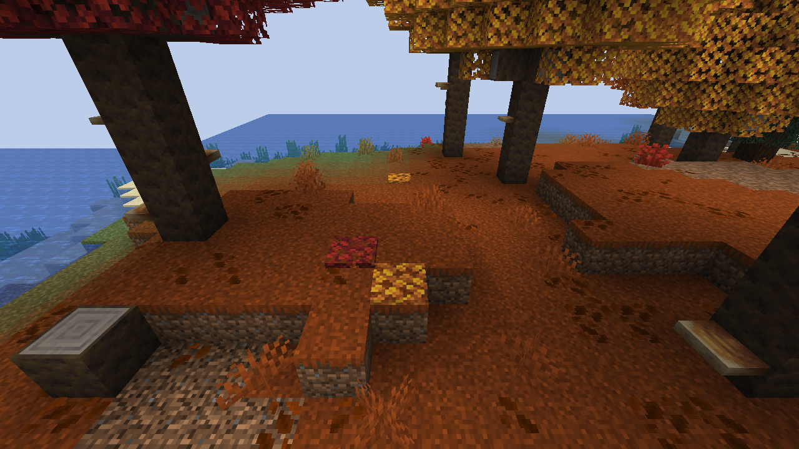
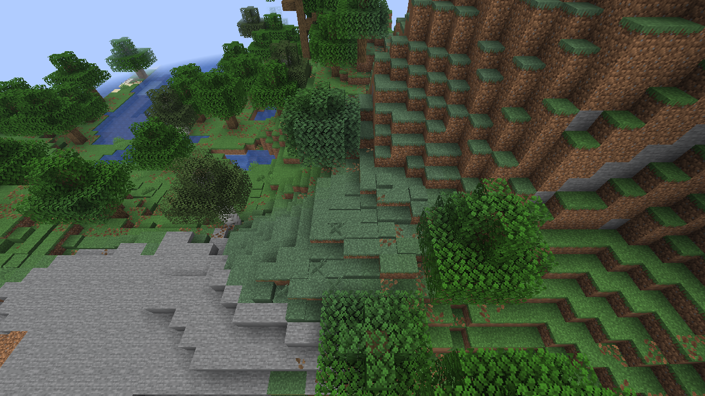

# Buildup Groundscape · 地表织景

为 Minecraft 的地表添加可堆叠的薄层、台阶和楼梯。用草皮修整坡道，用泥土、沙砾铺设小径，或在树下点缀落叶。

**v1.0.0 · Minecraft 26.3 · Fabric · Java 25**

客户端和服务端均需安装。支持生存合成与创造建造，自然生成可在配置中开启。

## 基本功能

### 地表方块

提供 11 种地表材质，共 38 个建筑方块。

| 材质 | 薄层 | 台阶 | 楼梯 | 完整方块 |
| --- | :---: | :---: | :---: | --- |
| 草地、菌丝、灰化土、绯红菌岩、诡异菌岩 | ✓ | ✓ | ✓ | 全表面草皮 |
| 泥土、砂土、缠根泥土、沙子、红沙、沙砾 | ✓ | ✓ | ✓ | 使用原版方块 |

- 薄层每层高 **1/8 格**，可堆叠至 **8 层**；台阶和楼梯支持原版的放置朝向、拼接与含水。
- 引用原版纹理，草地随生物群系着色，替换对应原版纹理的资源包也会作用于这些方块。
- 沙子、红沙和沙砾的新增变种不受重力影响。薄层需要下方支撑，失去支撑后消失。
- 薄层按覆地苔藓的速度挖掘，**仅精准采集掉落**，数量等于层数；普通挖掘不掉落薄层物品。
- 全部薄层不含水：**1–3 层可被水冲掉，4–8 层阻止水进入所在格**。冲刷不掉落薄层物品。

创造模式下可在“自然方块”分类查找；生存模式可用对应地表材料合成，并在薄层、台阶、楼梯之间转换。

### 植物共存

地表薄层可与 **22 种植物和地面装饰** 共存，包括矮草、蕨、常见小型花卉、干草、灌木，以及枯叶堆、野花簇和粉红色花簇。

- 手持支持的植物右键种植，基底条件沿用对应原版材质；植物随薄层高度显示。
- 创造和生存模式都先左键打掉植物，再挖掘薄层，植物沿用原版掉落规则。
- 枯叶堆和花簇保留数量与朝向，可继续右键追加。

两格高植物、树苗、作物、水生植物和第三方植物暂不支持共存；树叶薄层也不支持种植。共存花卉暂不参与蜜蜂授粉。

### 树叶薄层

为原版全部 **14 种树叶** 提供薄层：橡树、云杉、白桦、丛林、金合欢、深色橡树、红树、樱花、苍白橡树、杜鹃、盛开的杜鹃，以及红、橙、黄色杨树。

树叶薄层可叠至 8 层，不腐烂，使用对应树叶的纹理与颜色。一个原版树叶可合成八个薄层，也可合回原版树叶。

### 自然生成

**默认关闭。** 开启后，地表薄层根据坡向与高差生成，默认最多 7 层，平坦位置保留少量点缀。原始完整地表不会被替换，台阶和楼梯不参与生成。

树叶生成有独立开关，会在对应自然树冠下方少量生成 1–2 层落叶。两种生成都只作用于新区块，并避让结构、流体、积雪及危险地形；地表生成会保留已支持的共存植物。

## 安装与依赖

使用 Minecraft **26.3**、Java **25** 和 Fabric Loader **0.20.1 或以上**。

| 依赖 | 版本 | 是否必需 |
| --- | --- | --- |
| [Fabric API](https://modrinth.com/mod/fabric-api) | 0.165.0+26.3 或适用于 26.3 的兼容版本 | 客户端、服务端必需 |
| [YetAnotherConfigLib（YACL）](https://modrinth.com/mod/yacl) | **3.9.7+26.3-fabric** | 客户端、服务端必需 |
| [Mod Menu](https://modrinth.com/mod/modmenu) | 21.0.0 | 客户端可选，提供配置入口 |

将 `buildup-groundscape-1.0.0.jar` 与必需依赖放入 `mods` 文件夹，同一实例只保留一个版本。`-sources.jar` 是源码包，不用于游戏安装。

## 配置

游戏内输入 **`/groundscape-config`**，或通过 Mod Menu 的配置按钮打开界面。覆盖密度、坡面厚度、材质开关、树叶数量与树种都可在页面中调整，保存后无需重启。

- 要启用地表生成，打开“自然生成总开关”；树叶还需打开“树叶生成”开关。
- 单人主机和服务器管理员（权限等级 3 或以上）可保存配置，普通玩家只读。
- 设置只影响之后生成的新区块，不会补铺或重算已有地形；同一游戏或服务器实例的存档共用配置。
- 配置文件为 `config/buildup_groundscape-worldgen.json`。手动编辑后，可由管理员或服务器控制台执行 `/groundscape reload` 重载。

## 反馈

问题与建议请提交至 [Issues](https://github.com/DavidBlackCN/Buildup-Groundscape/issues)，附上 Mod 版本、复现步骤和必要的日志或截图。自然生成问题请同时提供种子、坐标与生成配置。

[更新记录](UPDATE_NOTES.md)

## 鸣谢

[Grass Overhaul](https://modrinth.com/mod/grass-overhaul)：草皮建筑形态的功能参考。本项目独立实现，未使用其源码、模型或贴图。

## 协议

[MIT License](LICENSE)。Minecraft 纹理由游戏在运行时提供，相关权利归其原作者所有。本项目不是 Mojang 或 Microsoft 的官方产品。
